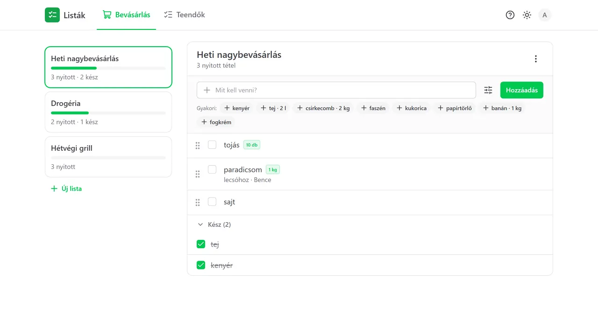
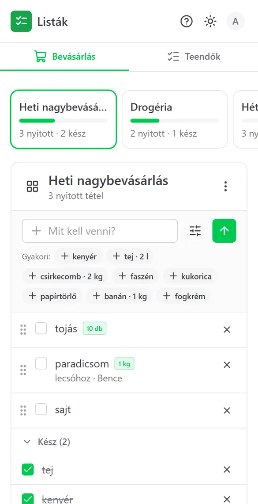
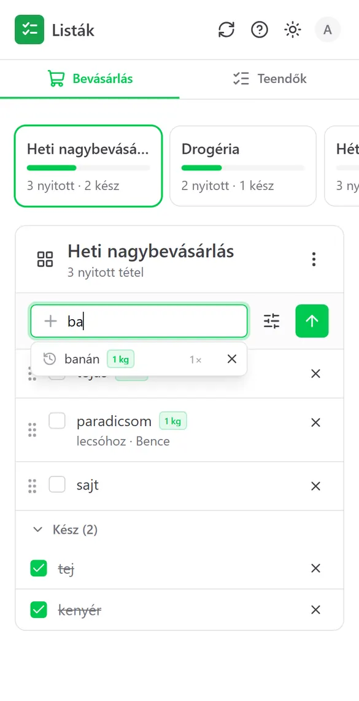
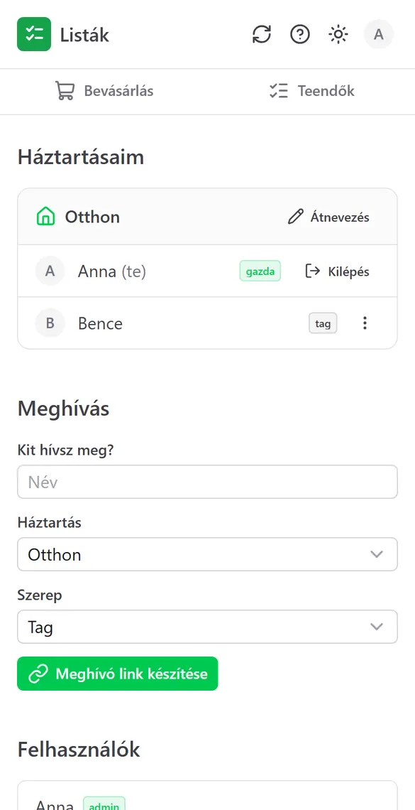
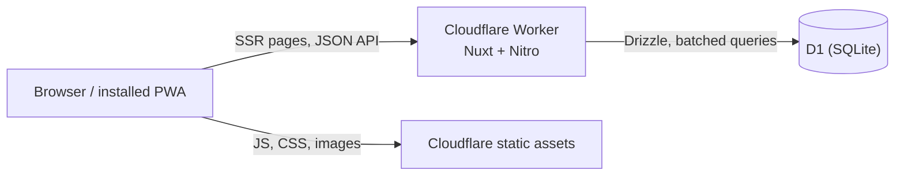

# Listák: shared shopping and to-do lists

[](https://github.com/DZoltan/shopping-list/actions/workflows/ci.yml)

A small household app for shared shopping and to-do lists: installable as a PWA,
passwordless login with passkeys, invite-only, and running entirely on Cloudflare's
free tier with no cold starts. The UI is in Hungarian; code and docs are in English.

<p align="center">
  <br>
  
  
  
</p>

## Features

- **Lists**: separate shopping and to-do lists per household, shown as tiles with
  progress; items with quantity and reason; check off, edit, drag to reorder.
- **Quick add**: suggestions from what the household added before, ranked by use count
  and recency, as a dropdown while typing and as one-tap "frequent" chips.
- **Households**: owners and members, invite links, roles, leave and remove, with rules
  that keep every household with an owner.
- **Passkeys only**: no passwords. Log in on another device with a QR code; admins can
  create recovery links.
- **PWA**: installable on Android, iOS and desktop, with an offline fallback for reading.
- **In-app browser detection**: Messenger, Facebook and Instagram open links in a WebView
  where passkeys silently fail; the app detects this and offers to open Chrome or Safari.

See the [changelog](CHANGELOG.md) for details.

## Stack

| Layer | Choice |
| --- | --- |
| Framework | [Nuxt 4](https://nuxt.com) (Vue 3, TypeScript), server routes on Nitro |
| UI | [Nuxt UI](https://ui.nuxt.com) (Tailwind CSS 4), `@vite-pwa/nuxt` |
| Hosting | Cloudflare Workers (`cloudflare_module` preset), static assets on Cloudflare |
| Database | Cloudflare D1 (SQLite) with [Drizzle ORM](https://orm.drizzle.team) and drizzle-kit migrations |
| Auth | [nuxt-auth-utils](https://github.com/atinux/nuxt-auth-utils) (sealed cookie sessions, WebAuthn via SimpleWebAuthn) |
| Validation | zod schemas shared by the server and the forms |



## Design decisions

- **Free tier as a hard constraint.** Workers Free allows 10 ms CPU per request and D1
  counts every scanned row. Every query filters on indexed columns, related statements go
  out in one `db.batch()` round trip, and the Worker bundle stays around 450 KB gzipped.
- **Passkeys instead of passwords.** A proper password hash (bcrypt, scrypt, Argon2) does
  not fit the 10 ms CPU budget, and password resets would need e-mail. Passkeys are cheap
  to verify, phishing-resistant, and the server stores only public keys.
- **Invite-only.** Sign-up needs an invite link (7 days, single use) or, for the very first
  admin, a one-time setup token. Tokens are 256-bit random values stored only as SHA-256
  hashes. WebAuthn challenges are stored server-side and consumed once, so captured
  responses cannot be replayed.
- **Household isolation in one place.** Every list and item query goes through helpers in
  `server/utils/access.ts` that scope it to the user's households. Data of other
  households answers 404, so ids cannot be probed. The e2e tests try every route from a
  second household.
- **Refetch, not realtime.** No WebSockets or Durable Objects: lists refetch when the tab
  or app regains focus, and changes are applied optimistically. For a household this is
  enough and keeps the app free and simple.
- **Links that survive chat apps.** Opening an invite or device link only looks it up;
  logging in needs a button press (a POST), because chat apps fetch links for previews.

## Project structure

```
app/                Nuxt app: pages, components, composables
server/api/         JSON API (file-based routes, e.g. lists/[id].get.ts -> GET /api/lists/:id)
server/db/          Drizzle schema (single source of truth) and generated migrations
server/utils/       DB helper, access checks, auth helpers (auto-imported)
server/middleware/  Requires a session for /api/* except the login routes
shared/             zod schemas, constants and helpers used by both app and server
tests/              E2E tests and the runner with a throwaway database
scripts/            Help screenshot generator
```

## Running locally

Requirements: Node.js 24, npm.

```bash
npm install
cp .env.example .env        # set NUXT_ADMIN_SETUP_TOKEN and NUXT_DATA_KEY
npx wrangler d1 migrations apply DB --local
npm run dev
```

Open http://localhost:3000/setup and create the admin account with the setup token from
`.env`; passkeys work on `localhost`. Local data lives in `.wrangler/state` (Miniflare)
and is separate from production. Then invite others from the *Háztartás és meghívás* page.

## Deploying to your own Cloudflare account

Everything fits the free plan; no credit card is needed.

```bash
npx wrangler login
npx wrangler d1 create shopping_list     # put the database_id into wrangler.jsonc
npx wrangler secret put NUXT_SESSION_PASSWORD   # 32+ random characters
npx wrangler secret put NUXT_ADMIN_SETUP_TOKEN
npx wrangler secret put NUXT_DATA_KEY           # 32+ random characters; keep a copy, see below
npx wrangler d1 migrations apply DB --remote
npm run build
npx wrangler deploy
```

Then open `/setup` on your `*.workers.dev` URL. Passkeys are bound to the hostname, so
pick the final domain before people register.

`NUXT_DATA_KEY` encrypts user and household names, list names and item texts in D1
(XChaCha20-Poly1305; suggestions are matched by an HMAC). Anyone with database access but
without the key sees no readable text. Store the key in a password manager: without it
that data cannot be recovered. Data written before encryption existed is converted with
the *Régi adatok titkosítása* button on the admin page.

## Tests

```bash
npm run typecheck
npm run test:e2e
```

`test:e2e` starts its own dev server with a fresh, temporary D1 database and runs
[`tests/auth.e2e.mjs`](tests/auth.e2e.mjs) against it: setup, invites, passkey login
(with a software ES256 authenticator), replay protection, device links, household rules,
and the isolation of one household from another across every API route. Your local data
is never touched. CI runs the same steps on every push.

## How this was built

I built this with [Claude Code](https://claude.com/claude-code) as a pair programmer: I
set the goals, constraints and architecture, reviewed and tested the changes, and made the
calls on trade-offs. [`CLAUDE.md`](CLAUDE.md) is the working agreement the assistant
followed, and commits it helped with carry a `Co-Authored-By` line.

## License

[MIT](LICENSE)
